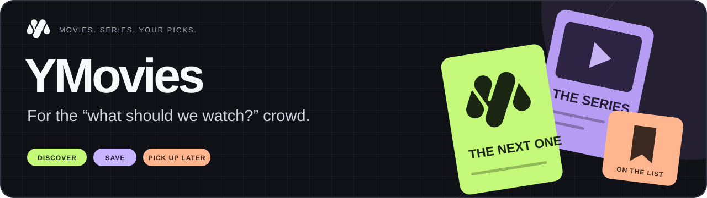
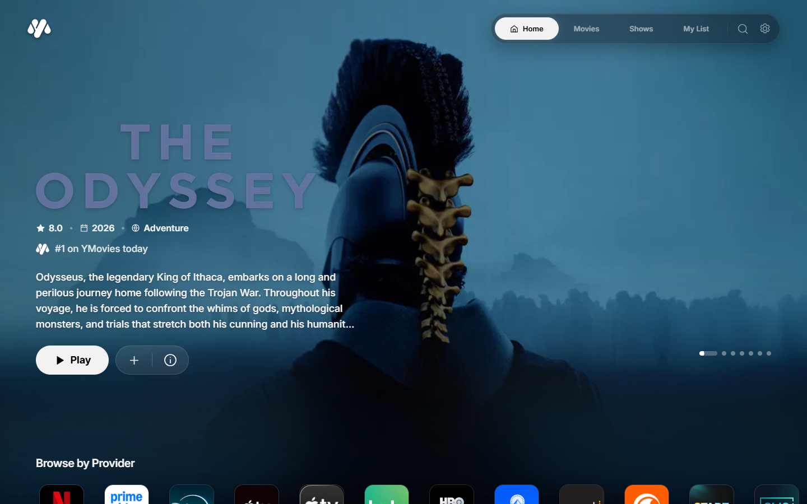

<picture>
  <source media="(max-width: 600px)" srcset="docs/images/readme/banner-mobile.svg" />
  
</picture>

<p align="center">
  <a href="#run-it">Run locally</a> &nbsp; / &nbsp;
  <a href="docs/ARCHITECTURE.md">How it works</a> &nbsp; / &nbsp;
  <a href="docs/CONTRIBUTING.md">Make it better</a>
</p>

<p align="center">
  <a href="https://ymovies.yerradouani.me">
    <picture>
      <source media="(max-width: 600px)" srcset="docs/images/readme/live-site-mobile.svg" />
      
    </picture>
  </a>
</p>

I built YMovies to make finding something to watch feel good, and remembering it easy. Browse movies and shows, watch trailers, explore a cast, and keep a library of favorites, watchlists and episode progress.

The interface is Svelte from end to end. SvelteKit renders pages and serves the API, TypeScript keeps the data in shape, and TMDB supplies the catalog. Browsing works without an account. Guest libraries stay on the device; signing in adds sync through Supabase and PostgreSQL.

## The stack, in full color

<p align="center">
  <a href="https://svelte.dev/"></a>
  <a href="https://svelte.dev/docs/kit"></a>
  <a href="https://www.typescriptlang.org/"></a>
  <a href="https://vite.dev/"></a>
  <a href="https://tailwindcss.com/"></a>
</p>
<p align="center">
  <a href="https://nodejs.org/"></a>
  <a href="https://supabase.com/"></a>
  <a href="https://www.postgresql.org/"></a>
  <a href="https://orm.drizzle.team/"></a>
  <a href="https://developer.themoviedb.org/"></a>
</p>

The optional recommendation service has its own little corner:

<p>
  <a href="recommendation_service/README.md"></a>
  <a href="https://flask.palletsprojects.com/"></a>
</p>

## A few good reasons to open it

| Find a good one                                                                              | Make it yours                                                        | Keep your place                                                                  |
| -------------------------------------------------------------------------------------------- | -------------------------------------------------------------------- | -------------------------------------------------------------------------------- |
| Browse movies and series, check the cast, play a trailer, or start with a genre or provider. | Save favorites, build a watchlist, and sort titles into collections. | Track movie progress and TV episodes. Keep it on your device or sign in to sync. |



## Run it

Use Node.js **22.12+**; Node.js 24 is used in CI.

```sh
npm ci
cp .env.example .env
npm run dev
```

On PowerShell, use `Copy-Item .env.example .env`. Open **http://localhost:5000**.

Set `TMDB_API_KEY` or `TMDB_BEARER_TOKEN` to load the catalog. Without credentials, the app shows an unavailable state. Accounts are optional: the [setup guide](docs/setup/INSTALLATION.md) explains the Supabase and database variables. Keep server credentials out of `PUBLIC_` variables and source control.

## Bring your own editor

| Command                   | What it does                                                         |
| ------------------------- | -------------------------------------------------------------------- |
| `npm run dev`             | Starts the local app on port 5000                                    |
| `npm run doctor`          | Checks setup without printing secrets                                |
| `npm run check`           | Checks Svelte and TypeScript                                         |
| `npm test`                | Runs the application and security tests                              |
| `npm run format`          | Formats source and documentation                                     |
| `npm run format:check`    | Checks formatting                                                    |
| `npm run build`           | Builds the Node server into `build/`                                 |
| `npm start`               | Runs that server, loading local environment files when present       |
| `npm run test:api`        | Checks a running server's API boundaries                             |
| `npm run test:browser`    | Checks guest flows on desktop and mobile in Chrome                   |
| `npm run test:design`     | Checks layouts, motion and preferences; records browser frames       |
| `npm run test:navigation` | Checks desktop/mobile transitions, history, reduced motion and fonts |
| `npm run test:seo`        | Checks server-rendered metadata, sitemap and security headers        |
| `npm run test:analytics`  | Checks Google tag loading and navigation without sending real visits |
| `npm run db:push`         | Applies the schema to the configured database; review changes first  |

Browser checks accept `TEST_BASE_URL` and `CHROME_PATH`. Account sign-in, email delivery and production analytics need verification against your own services.

Start with [architecture](docs/ARCHITECTURE.md), [design](docs/DESIGN.md), [API](docs/api/API_DOCUMENTATION.md), or [contributing](docs/CONTRIBUTING.md). Deployment instructions are [here](docs/deployment/DEPLOYMENT.md); report security issues using [SECURITY.md](SECURITY.md).

<details>
<summary><strong>The search and analytics bits</strong></summary>

Public pages render titles, descriptions, canonical links and structured data on the server. `/genres` and `/providers` connect the catalog; `/about` identifies the creator. `/sitemap.xml` lists public routes and current trending titles. Private pages, search results and filtered duplicates are excluded from indexing. There are no ranking guarantees or fabricated ratings.

The Google tag **G-0HC7C4GFD5** loads once in `src/app.html`. SvelteKit navigation sends explicit page views from `src/lib/analytics.ts`; query strings and URL fragments are removed first. In the GA4 stream, keep **Enhanced measurement → Page views → Advanced settings → Page changes based on browser history events** disabled to avoid counting navigation twice. The initial automatic page view is disabled in code. See [Google's page view guidance](https://developers.google.com/analytics/devguides/collection/ga4/views).

</details>

## Credits

Movie and TV metadata comes from [TMDB](https://www.themoviedb.org/), with availability data from JustWatch through TMDB.

YMovies is not endorsed or certified by TMDB.

The bundled Inter font retains its [SIL Open Font License](static/fonts/Inter-OFL.txt); shader attributions are kept beside their source.

Technology badges use [Shields.io](https://shields.io/) and [Simple Icons](https://simpleicons.org/). The banners use the project's own artwork.

[MIT license](LICENSE).

Made by [Yassine Erradouani](https://yerradouani.me).
